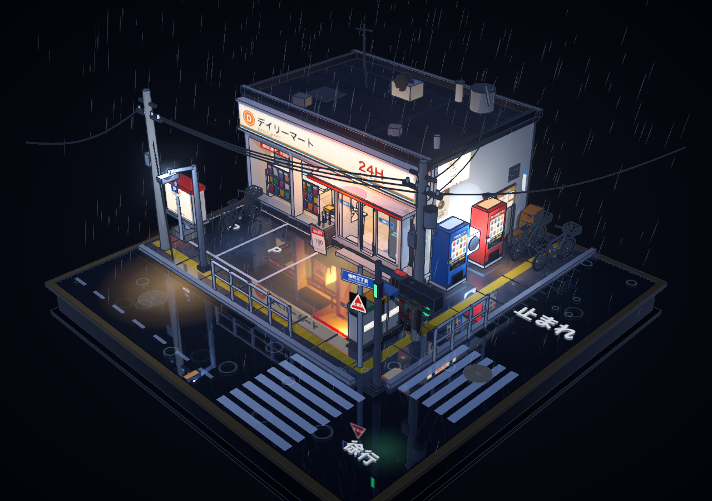
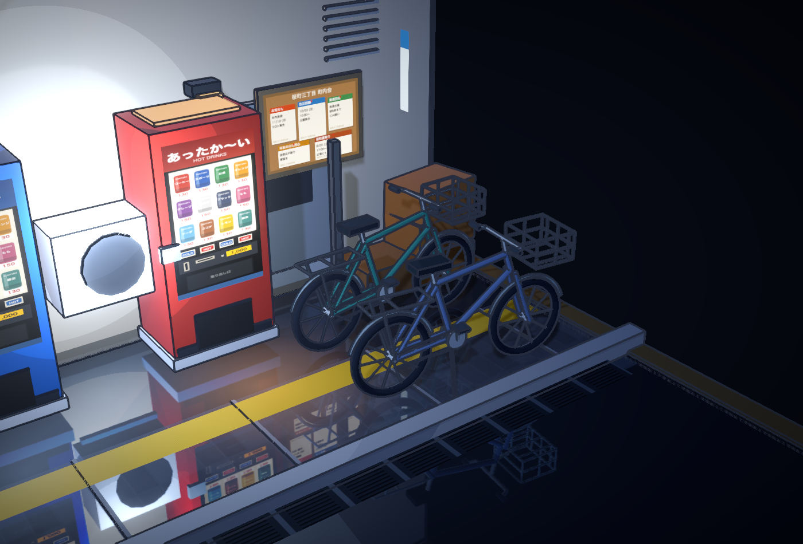
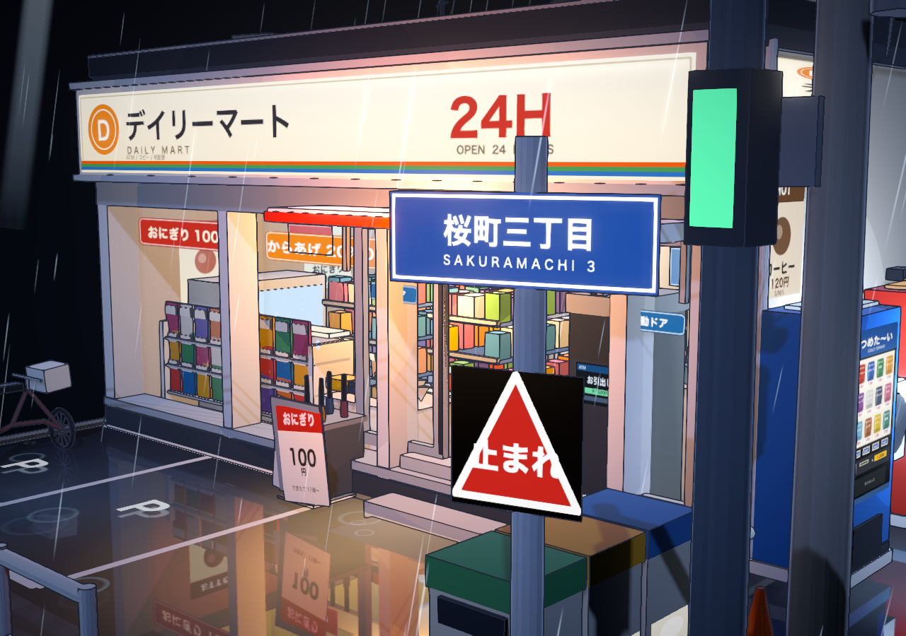
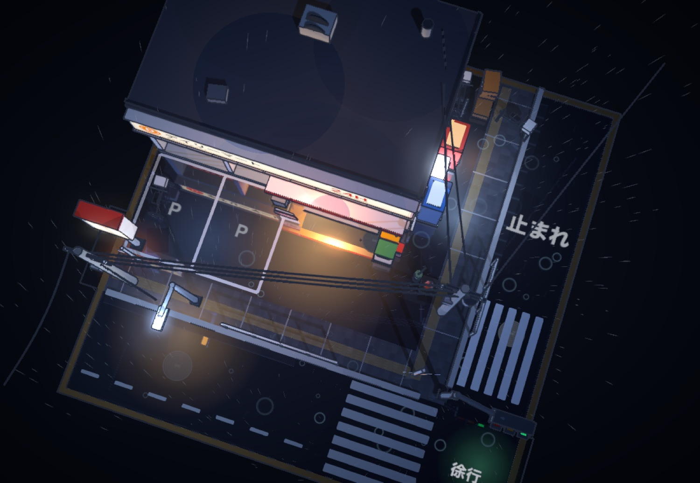
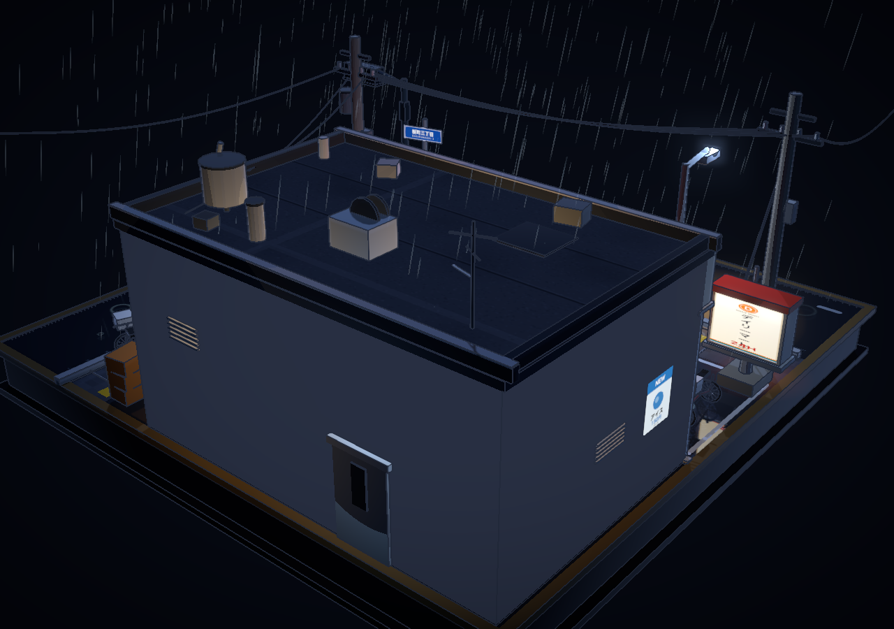

# 雨夜便利店街角 · Rainy Convenience Store Corner

当前版本：**v2.0.1** · [更新记录](CHANGELOG.md) · [渲染验证](docs/render-fix/verification.md)

一个可以在浏览器里自由拖拽、旋转、缩放的**日式便利店街角微缩模型**：
三渲二卡通渲染、程序化生成的贴图、湿漉漉的夜景反射，以及恰到好处的细微动态。

> 单文件 HTML，不联网、不依赖任何外部资源，双击即可打开。



---

## 在线体验

**在线体验 → https://gn3m1x.github.io/rainy-conbini/**

本地体验：直接双击 `index.html`（单文件，无需服务器）。

## 操作

| 操作 | 效果 |
| --- | --- |
| 鼠标左键拖拽 | 环绕旋转整个模型 |
| 滚轮 / 双指 | 推近拉远（限制在 3~17 单位之间） |
| 鼠标右键拖拽 | 平移观察中心 |
| 无操作 6 秒 | 镜头缓慢自动环绕，一动就停 |

画面里没有任何 UI 元素：没有按钮、没有文字说明、没有标记点，只有加载时 1.4 秒的淡入。

## 场景内容

**底座**：5.2×5.2 的正方形模型底座，深色木纹台面感，所有元素都固定其上。

**店外**：便利店本体（发光招牌「デイリーマート / 24H」、三面玻璃橱窗、自动门、雨棚、地垫、侧招牌）、
自动贩卖机 ×2、自行车 ×3、雨伞架、分类垃圾桶、路灯、电线杆 ×2 与悬垂电线、交通信号灯与行人灯、
蓝色路牌「桜町三丁目」与止まれ、街角护栏、两个停车位、排水沟与井盖、斑马线 ×2、小巷入口、
空调外机、A 字广告牌、公告栏、啤酒筐、地面光池与积水。

**店内**（透过大面积玻璃可见）：饮料柜 ×3、中岛货架 ×2（商品逐件实例化排列）、饭团便当陈列、
关东煮柜台、收银台与收银机、咖啡机、热食柜、杂志架、海报、吊旗灯箱、ATM、地面导视箭头、后场门、瓷砖地面。

## 动效

- 持续降雨（620 条始终朝向相机的雨丝，避开建筑体积）
- 屋檐与落水管滴水、地面积水涟漪
- 招牌与灯箱轻微闪烁
- 自动门每隔数秒自动开合
- 雨水沿玻璃缓慢下滑
- 交通信号灯红 / 绿 / 黄循环
- 地面实时镜面反射，霓虹与路灯在积水里拉出倒影

## 技术实现

- **three.js r169**，esbuild 打包成单个 IIFE HTML（约 660KB，含全部代码与贴图）
- **三渲二**：`MeshToonMaterial` + 自制 5 阶色阶贴图 + shader 内注入轮廓补光；
  自写后处理边缘检测（深度差 + 法线差双通道）绘制描边，叠加轻微色偏、暗角、弱泛光与 SMAA
- **贴图**：全部用 canvas 程序化绘制（招牌、海报、饭团包装、斑马线、路面文字、井盖、贩卖机面板、玻璃雨痕…），
  仓库里没有一张外部图片
- **湿地反射**：`Reflector` 实时镜面 + 半透明地面覆盖层，兼顾反射与材质层次
- **合批**：按材质与绘制层级合并静态几何（`BufferGeometryUtils.mergeGeometries`）减少 draw call

## 目录结构

```
index.html          # 构建产物：单文件场景，双击可玩（也可直接当 GitHub Pages 首页）
src/
  main.js           # 渲染器 / 相机 / OrbitControls / 主循环 / URL 调试参数
  core/materials.js # 调色板、toon 材质、玻璃、发光材质
  core/tex.js       # 全部程序化 canvas 贴图
  core/kit.js       # 几何工具与按材质合批
  world/index.js    # 场景编排、灯光、地面反射
  world/base.js     # 底座、路面、标线、积水
  world/store.js    # 便利店建筑与店内陈设
  world/props.js    # 街道道具
  world/fx.js       # 雨、涟漪、滴水、闪烁、自动门、信号灯
  post/composer.js  # 后处理：法线深度、描边合成、泛光、SMAA
build.mjs           # 打包脚本
shot.sh             # 用 headless Chrome 截图（macOS）
```

## 构建

```bash
npm install          # 或 npm_config_cache=.npmcache npm install
npm run build        # 同步生成 index.html 和 out/rainy-conbini.html
```

## v2.0.1：门、墙角与自行车

- 自动门移到独立滑动轨道平面，整段开合行程避开固定立柱与玻璃。
- 拆开左下角地台、侧墙、踢脚及角柱的共面重叠，修复转动时的局部闪烁。
- 三辆自行车全部重建：正确朝向的圆轮、完整车架、辐条、挡泥板、脚踏、后货架与镂空车筐。
- 调整停车区及右侧车辆的位置，并为箱子、贩卖机和墙体留出空间。
- 新增 6 项真实几何检查，加上原有 22 项渲染与交互检查，共 28 项通过。

[几何修复记录与近景截图](docs/geometry-fix/verification.md)



## 渲染修复与验证

保留原来的三渲二配色、街角布局、雨夜反射、无 UI 画面及灯箱微动，修复了以下问题：

- **描边穿透**：不透明招牌和灯箱参与法线/深度遮挡；透明玻璃、光池、雨丝与不写深度的贴花不再被当成实体矩形绘制轮廓。
- **转动时地面闪变**：为湿地面、标线细节、光池固定叠加顺序，静态合批保留 `renderOrder`，避免镜头方向改变透明层的显示顺序。
- **高 DPI 描边错位**：所有后处理通道统一使用实际画布的整数像素尺寸，初次加载与窗口缩放使用相同描边宽度。
- **共面闪烁**：天花板灯片与外框表面留出微小间距，避免深度争抢。
- **固定时间仍在运动**：`?t=9&rot=0` 现在会先推进到第 9 秒，再冻结全部动效；`?fx=0` 也会真正关闭天气与动效。

测试使用真实 Chrome/WebGL 渲染、像素对照和实际场景交互。执行方式（需安装 Chrome）：

```bash
python3 -m venv .venv-test
source .venv-test/bin/activate
pip install -r tests/requirements.txt
npm ci
npm run build
npm run test:render
npm run test:geometry
```

脚本自行启动临时 HTTP 服务，另行验证 `file://` 离线打开。截图及详细结果输出到被 Git 忽略的 `shots/`；
本次保存的[修复记录](docs/render-fix/verification.md)和截图用于人工复查。

## 调试参数

地址栏可加参数，方便截图与调参：

`?t=9` 固定完整动效到第 9 秒（范围 0–120 秒） · `?rot=0` 关闭自动旋转 · `?cam=x,y,z` / `?tgt=x,y,z` 指定机位 ·
`?post=0` 关闭后处理 · `?bloom=0` · `?shadow=0` · `?fx=0` 关闭天气与动效

常用调参位置：`src/world/index.js`（灯光强度）、`src/post/composer.js`（描边粗细与泛光）、
`src/main.js`（初始机位与焦距）。

---




