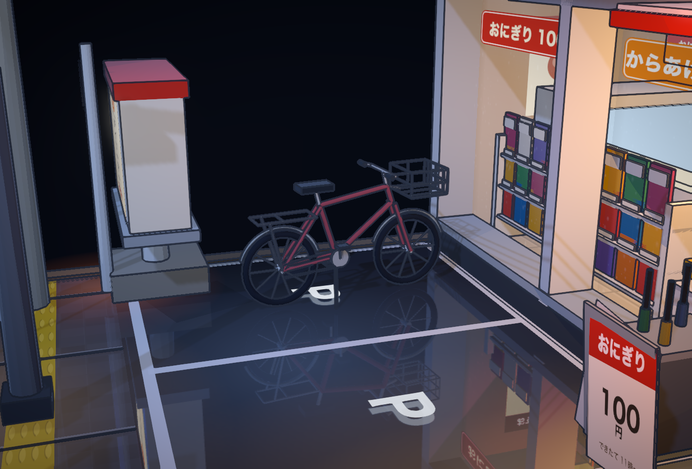
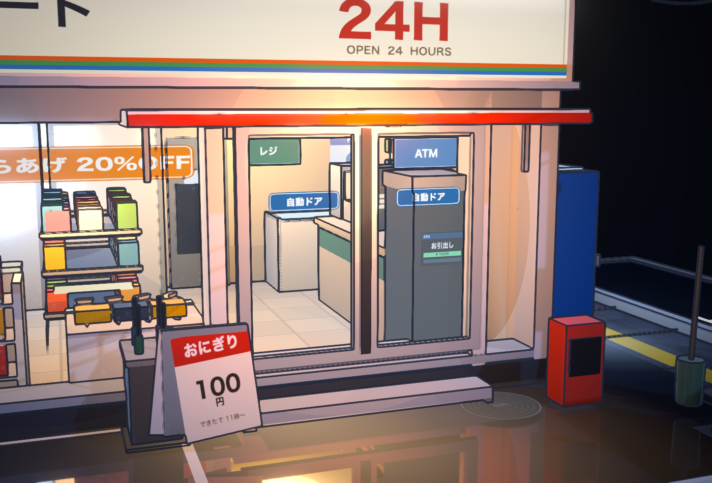
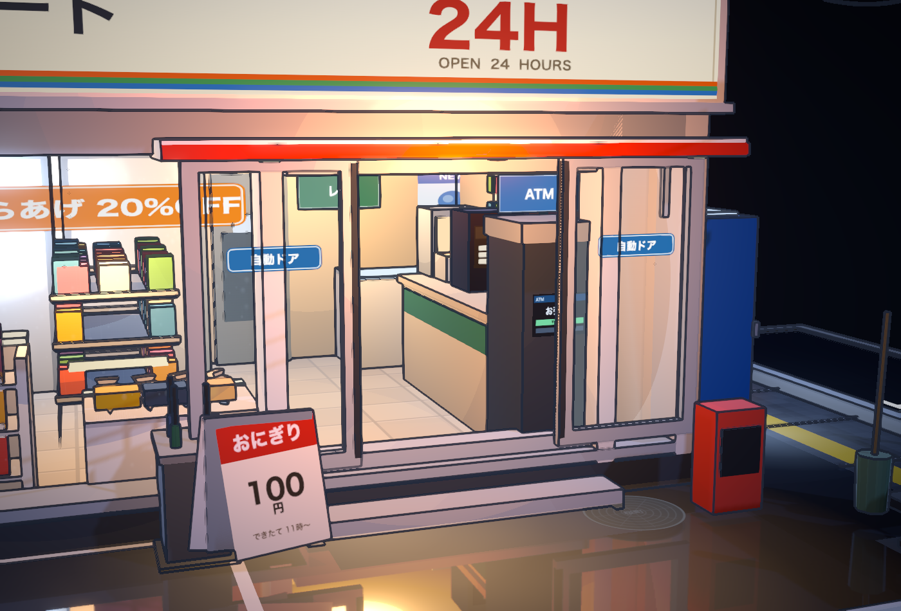
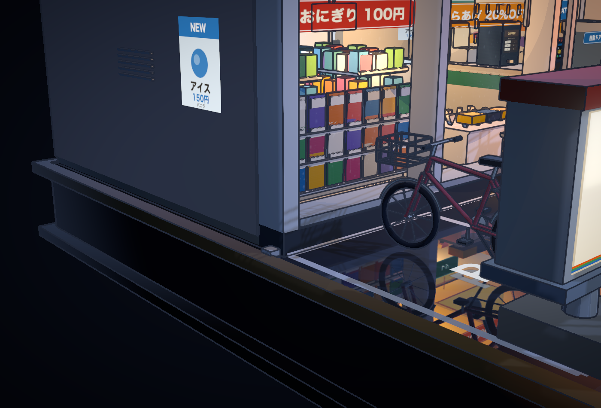

# v2.0.1 几何修复与自行车重建

验证日期：2026-10-19（Asia/Taipei）。基准版本：`v2.0.0` / `f876aaed78cac963397cd75336ebbac4a673912f`。

本轮针对用户指出的右侧自动门穿模、正面左下角持续闪烁，以及三辆自行车结构不清晰，补充真实场景的几何回归检查。

## 原因和修改

- **自动门**：旧门扇与固定立柱处于相同的前后深度，右扇在关闭及滑开时都会进入立柱。两扇门改到独立外侧滑动平面，按实际门洞计算闭合宽度，保留 0.30 单位的滑动行程。
- **左下角**：地台、侧墙、立柱、踢脚和铝条有同朝向、同平面且占据正面积的重叠面。地台结束于墙柱接缝，侧墙从地台顶面开始，立柱从踢脚顶部开始，铝条止于角柱内侧，避免用叠在一起的盒子拼出外立面。
- **自行车**：旧轮胎额外旋转了 90°，使轮胎平面与车架垂直。三辆车均重建为车轮、辐条、车架共面的城市自行车，并增加轮辋、挡泥板、前叉、链轮、脚踏、后货架和镂空车筐。轮径与轴距之比由约 0.405 调整为 0.5。
- **摆放**：停车区车辆移到更清楚的位置；右侧两辆车沿侧巷分开排列并使用不同车架颜色。箱子移到墙边，车辆与墙、贩卖机、公告栏支柱、箱子及路缘石留出间距。

## 自动验证

新增 6 项几何检查全部通过，原有 22 项真实 Chrome/WebGL 渲染检查全部通过，共 **28/28 项**。

| 检查 | v2.0.0 | v2.0.1 |
| --- | ---: | ---: |
| 30 秒门动画中，60 次半秒采样及初始状态命中的立柱碰撞记录 | 272 | 0 |
| 左下角同朝向外表面的共面重叠组数 | 8 | 0 |
| 车轮轴线相对轴距方向的投影绝对值（应接近 0） | 三辆均约 1 | 三辆均小于 1e-14 |
| 车轮直径 / 轴距 | 0.405 | 0.5 |
| 自行车部件与周边实体的包围盒相交 | 检查失败 | 0 |
| 自行车部件留在方形底座范围内 | 通过 | 通过 |

碰撞检查使用合批前真实网格的世界坐标与部件包围盒；自行车与实体障碍物采用保守的部件包围盒检查。测试记录命中代表采样时的相交记录数，并非物体数量。

复现旧版失败：

```bash
node tests/build-fixture.mjs --geometry-baseline v2.0.0
python3 tests/geometry.py --baseline
```

检查当前版本（需按 README 配置测试虚拟环境及 Chrome）：

```bash
npm run build
npm run test:render
npm run test:geometry
```

几何检查辅助代码只注入测试构建，交付的 `index.html` 不包含测试全局对象。

记录：[旧版失败](baseline-results.json)、[本次几何检查](geometry-results.json)、[渲染回归](render-results.json)。

## 实际场景截图







