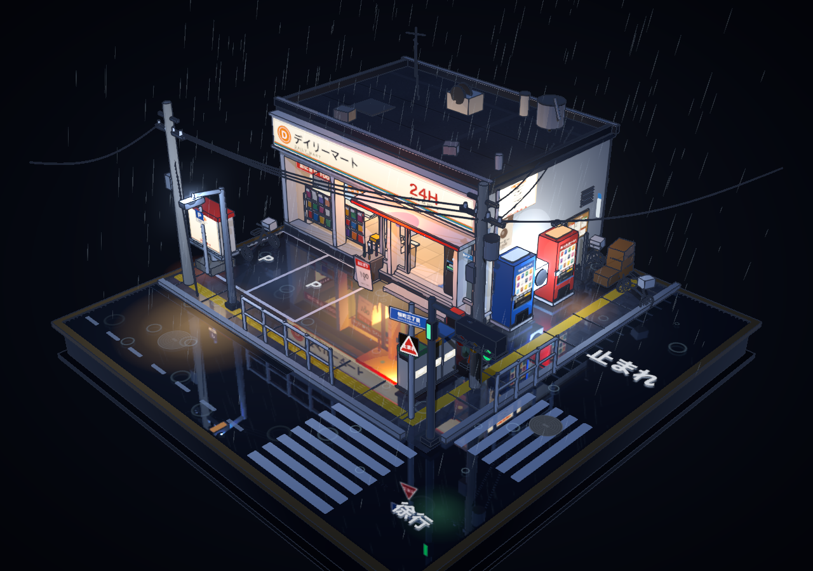
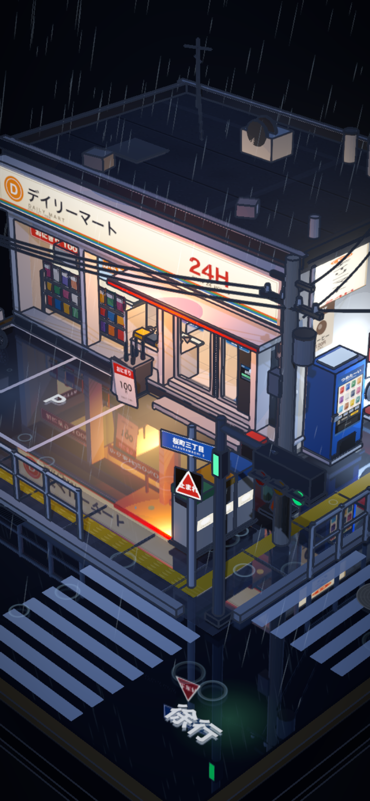
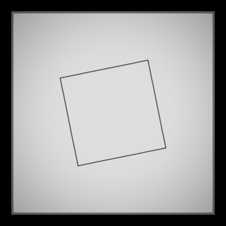
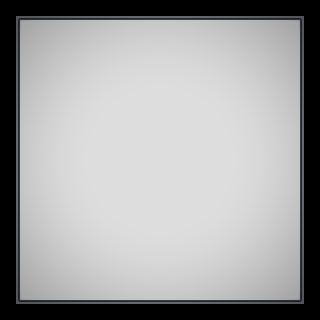

# 雨夜便利店：描边与闪烁修复验证

验证日期：2026-10-19（Asia/Taipei）。原版基准为 `d96fb39348631c3cac9fc2aeff122125833f2d52`。
本文记录 v2.0.0 的发布验证；源代码、单文件构建产物、回归测试与截图一并纳入本次更新。

## 原因与修复

1. 原先的 `hidden` 列表同时包含玻璃、光池和不透明招牌。法线/深度通道把这些对象全部隐藏，导致招牌后方物体的边线被合成到招牌前面。现在按实际材质处理遮挡：保留不透明表面，排除透明覆盖层及不写深度的表面，并保留材质面向与偏移属性。反射器不参与辅助通道，避免额外递归反射。
2. 原先的静态合批只按材质分组，丢失 `renderOrder`。湿路面和标线均不写入深度，转动镜头会让透明排序反转。现在先绘制地面底色，再绘制标线和细节，最后叠加光池；这些地面层都位于玻璃与雨丝之前，合批保留层级。
3. 390 CSS 像素宽、DPR 2（渲染 DPR 上限 1.75）的设备，实际画布宽度为 682，但原来的辅助通道四舍五入成 683。现在后处理统一使用实际整数画布尺寸，初次载入与 resize 也采用同一描边宽度规则。
4. 六盏天花板灯的发光面与灰色外框底面原本完全共面，向上射线命中距离均为 `0.1460000038`。灯片下移 0.004 单位后，两表面分离，避免深度争抢。
5. `?t=9` 原来只固定传入时间，仍按每帧 `dt=1/60` 推进雨、涟漪和自动门。现在只预推进一次到目标时间，再以 `dt=0` 更新朝向；`?fx=0` 关闭天气和动效。普通播放仍保留原版灯箱轻微闪烁。
6. 构建命令同时更新根目录 `index.html` 与 `out/rainy-conbini.html`，避免实际打开的单文件仍是旧版。

## 可重复的像素对照

以下三个测试使用同一 Chrome、机位和最小场景，分别加载原版与修复后的真实渲染/合批代码。可见变化像素以任一 RGB 通道差值大于 8 为阈值。

| 检查 | 原版 | 修复后 |
| --- | ---: | ---: |
| 不透明面被背后轮廓污染 | 1,376 像素 | 0 像素 |
| 镜头两侧观察同一标线的最大 RGB 通道差 | 138 | 0 |
| 透明贴花空白边缘出现矩形描边 | 1,412 像素 | 0 像素 |

原版复现执行并按预期失败：

```bash
node tests/build-fixture.mjs d96fb39348631c3cac9fc2aeff122125833f2d52
python3 tests/rendering.py --baseline
```

记录见 [baseline-results.json](baseline-results.json)。

## 完整验证

```bash
npm run build
npm run test:render
```

浏览器测试需在安装了 `tests/requirements.txt` 的 Python 虚拟环境中运行，并安装 Google Chrome。测试脚本自行启动临时 HTTP 服务。

最终 **22/22 项通过**，完整记录见 [results.json](results.json)。覆盖：

- 三项像素回归，以及辅助渲染异常后正确恢复材质、可见性、背景、渲染目标和阴影状态。
- 完整场景在固定时间的两帧逐字节相同；正面、侧面、背面及近景渲染。
- 灯片与外框的真实几何间距。
- 拖拽旋转、滚轮缩放、右键平移。
- 雨继续运动、信号灯切换、自动门完整开合。
- 初次加载、resize 与高 DPI 下辅助缓冲区/合成分辨率/画布尺寸一致；尺寸往返后描边一致。
- 390×844、DPR 2 竖屏无溢出；无 UI 元素。
- 根目录单文件通过 `file://` 直接打开；无外部资源依赖；无 JavaScript 或 shader 错误。

另通过 JavaScript/Python 语法检查、`git diff --check`，并确认两个 HTML 构建产物逐字节一致。
验证覆盖本机 Chrome；其他浏览器及 GPU 尚未实测。

## 截图






描边最小复现（白色面板完全遮住后方方块）：



