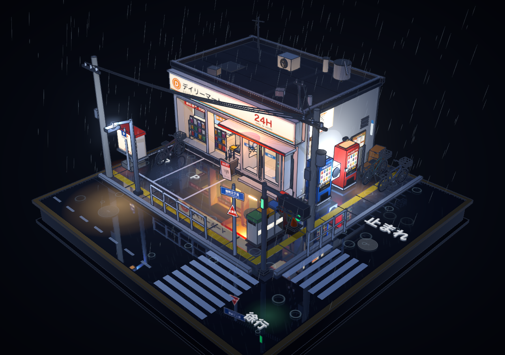
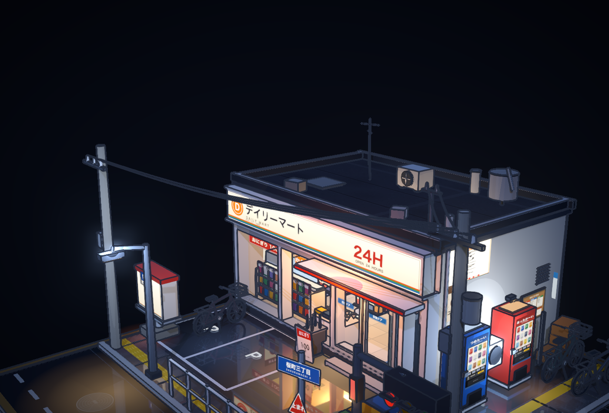
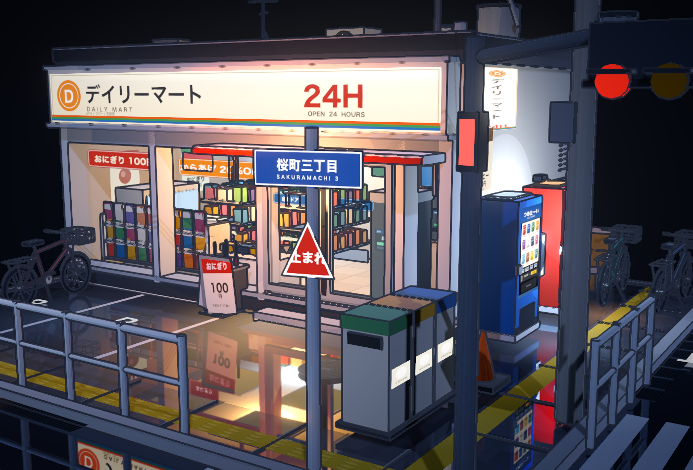
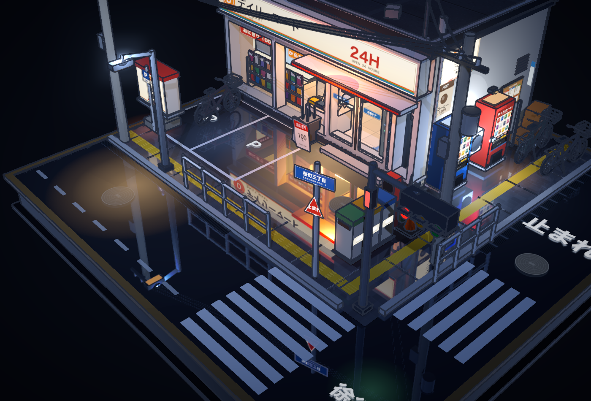
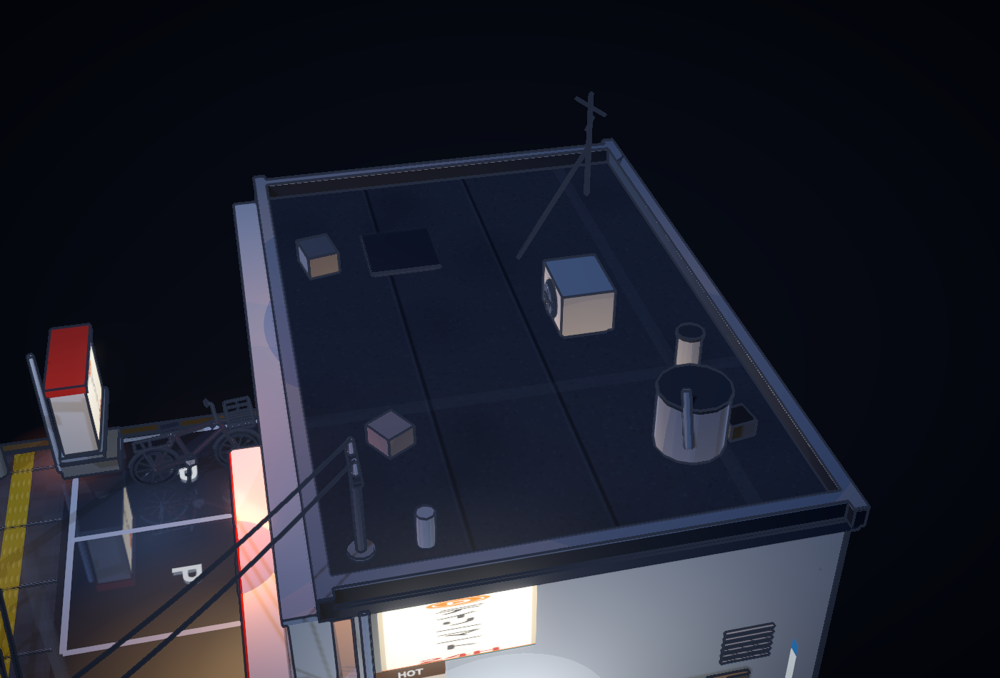

# v2.0.2 街道、电线、告示牌与屋顶修复

日期：2026-10-19（Asia/Taipei）。基准：`v2.0.1` / `5c72eea9a16f289944fdcb40fe528933b2217d4d`。

## 原因与修改

1. **电线支撑和走向**：旧线路没有共用横担和绝缘子的坐标，有的线尾悬空，有的低于横担或穿进屋顶。改为三条平行杆间线路和两条入户支线；所有端点与实际绝缘子顶点一致。屋顶新增接线杆、绝缘子和入屋导管底座，线身保持在女儿墙及设备上方。移除没有接点的出画面线尾。
2. **通道布局**：路灯、电线杆、路牌及斜拉线原本占据盲道，缺少对通道的避让。杆件移到盲道与路缘石之间的设施带，斜拉线移除；调整信号灯底座以避开路缘。路灯实际光源随灯头位置更新。盲道保持连续。
3. **井盖**：东侧井盖原本位于斑马线内，现移到其北侧的车道空白处；店前井盖移到台阶外，保留三处井盖。
4. **三角告示牌黑框**：三角形纹理贴在不透明矩形面上，透明角落仍被当成黑色实体渲染。改用真实三角形顶点、法线和 UV，前后两面均保留三角轮廓；白边绘制在三角形内。
5. **屋顶闪烁**：四条女儿墙在角落互相覆盖，产生同朝向共面表面；空调圆盘也与机壳前面重合。侧墙及四边压顶按接缝长度衔接，空调加支脚，风机边圈、圆盘、叶片、中心轮毂分层布置，避免重叠共面。

## 回归检查

新增 7 项检查，使用实际合批前几何、世界坐标、电线曲线采样、纹理与网格面积计算。旧版 7 项均失败，修复后 7 项均通过。

| 检查 | v2.0.1 | v2.0.2 |
| --- | ---: | ---: |
| 未对齐绝缘子的电线端点 | 14 | 0 |
| 线身与建筑/横担等盒体相交记录 | 8 | 0 |
| 侵入盲道的杆件/拉线记录 | 5 | 0 |
| 与斑马线重叠的井盖 | 1 | 0 |
| 告示牌不透明矩形背景 | 前后两面 | 无；两面网格面积均为外接矩形的 0.5 |
| 屋顶同朝向共面重叠面记录 | 8 | 0 |
| 风机圆盘与机壳共面记录 | 1 | 0 |

电线穿模检测将每条曲线采样为 160 段，并对实际实体包围盒留出微小余量；端点对照实际绝缘子顶面。盲道及井盖检查直接读取地面纹理和网格覆盖范围。屋顶检查比较同向平面坐标及覆盖面积，不将正常相接的边界当成重叠面。

原有 6 项门与自行车几何检查、22 项 Chrome/WebGL 渲染及交互检查全部继续通过，合计 **35/35 项**。覆盖本机 Chrome，未进行其他浏览器/GPU 的实机验证。

在 README 所述测试虚拟环境中执行：

```bash
npm run build
npm test
```

复现旧版失败：

```bash
node tests/build-fixture.mjs --geometry-baseline v2.0.1
python3 tests/street.py --baseline
```

原始记录：[旧版失败](baseline-results.json)、[本轮 7 项](street-results.json)、[门与自行车 6 项](geometry-results.json)、[渲染及交互 22 项](render-results.json)。

## 实际截图






